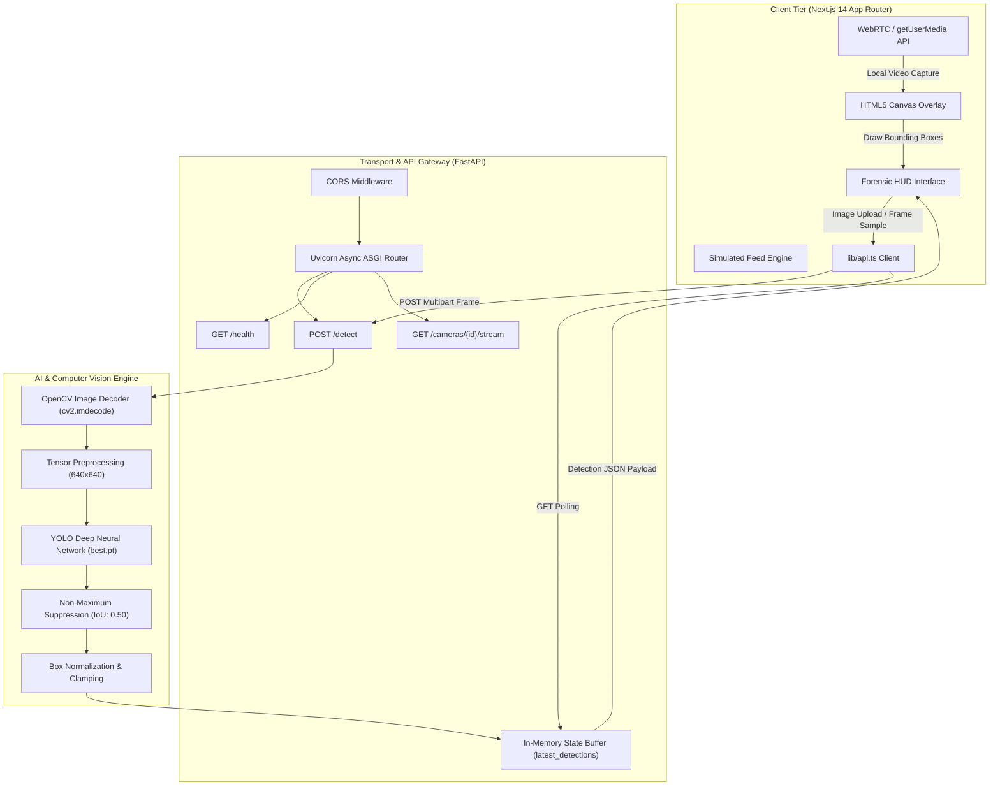
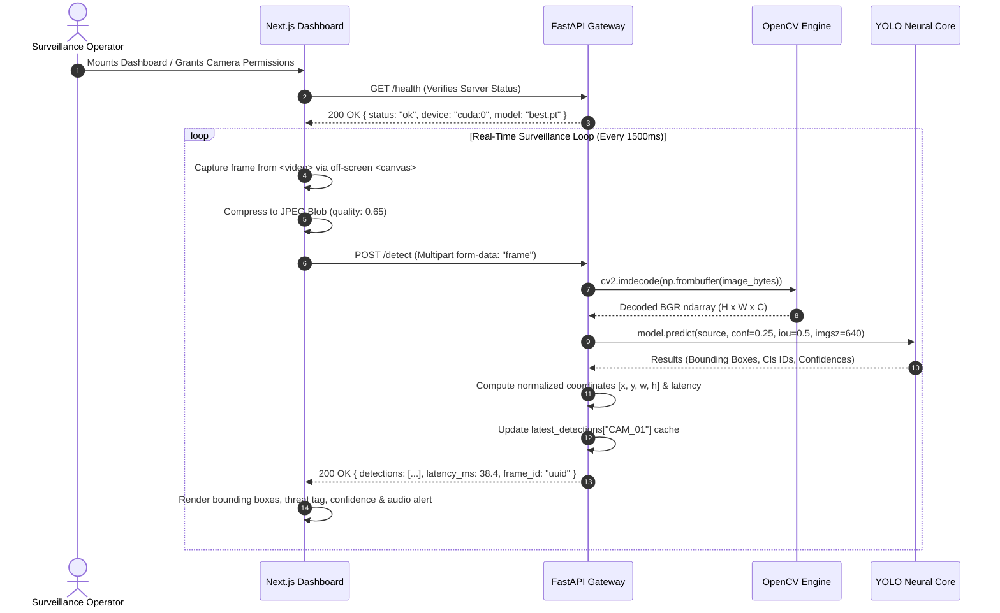
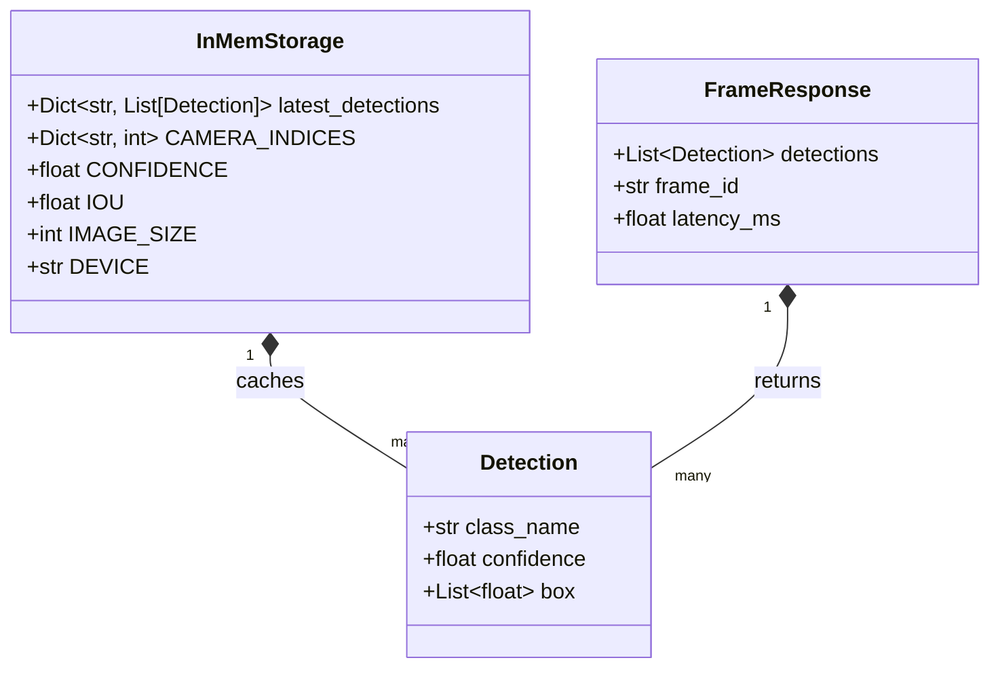
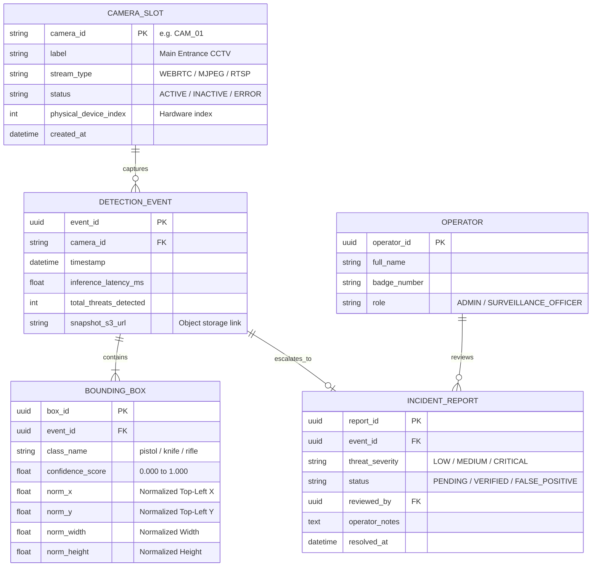

# 🔫 WD-SYSTEM: Automated Weapon Detection & Surveillance Dashboard

[](https://fastapi.tiangolo.com/)
[](https://nextjs.org/)
[](https://github.com/ultralytics/ultralytics)
[](https://pytorch.org/)
[](https://opencv.org/)
[](https://www.typescriptlang.org/)
[](https://tailwindcss.com/)
[](https://opensource.org/licenses/MIT)

> **Real-time computer vision surveillance system powered by custom-trained YOLO object detection, asynchronous FastAPI streaming backend, and a forensic-evidence styled Next.js 14 dashboard.**

🔗 **Live Deployment:** [weapon-detection-three.vercel.app](https://weapon-detection-three.vercel.app/)  
👥 **Authors:** [Abhinav Gupta](https://github.com/abhinavgupta30) & [Sanidhya Singh Sisodiya](https://github.com/Sanidhyacodes-03)

---

## 📑 Table of Contents

- [Overview](#-overview)
- [Key Features](#-key-features)
- [System Architecture](#-system-architecture)
- [Block Diagram](#-block-diagram)
- [Project Flow & Data Pipeline](#-project-flow--data-pipeline)
- [Database & State Management Schema](#-database--state-management-schema)
- [Tech Stack](#-tech-stack)
- [Project Structure](#-project-structure)
- [Model Training & Dataset Pipeline](#-model-training--dataset-pipeline)
- [API Reference](#-api-reference)
- [Installation & Setup](#-installation--setup)
- [Multi-Device Network Configuration](#-multi-device-network-configuration)
- [Deployment Guide](#-deployment-guide)
- [Performance Benchmarks](#-performance-benchmarks)
- [Troubleshooting & FAQ](#-troubleshooting--faq)
- [License & Ethical Disclaimer](#-license--ethical-disclaimer)

---

## 📌 Overview

**WD-SYSTEM** (*Case File: WD—2026.0847*) is an end-to-end tactical weapon detection platform designed to detect concealed and drawn threats (handguns, knives, rifles, and unattended explosives) in real time. 

Built to demonstrate how modern edge-AI and high-performance web interfaces converge in mission-critical surveillance, the platform couples an **Ultralytics YOLO** neural network with a low-latency **FastAPI** inference gateway and a cyber-forensics themed **Next.js 14** control room.

```
       [ Physical Cameras / Video Upload ]
                       │
                       ▼
            [ Next.js 14 Client UI ] 
        (Live WebRTC Sampling & Controls)
                       │
             HTTP / Multipart POST
                       ▼
           [ FastAPI Async Backend ]
       (Frame Decoding & Tensor Staging)
                       │
                       ▼
             [ YOLO Deep Model ]
      (Bounding Boxes + Confidence Scores)
                       │
                       ▼
          [ Real-Time HUD Overlay ]
     (Bounding Bounding Boxes + Alert Telemetry)
```

---

## ⚡ Key Features

- 🎯 **Real-Time Threat Detection:** Sub-50ms inference latency on GPU (CUDA) and optimized CPU fallback for real-time video frames.
- 📹 **4-Camera Multi-View CCTV Matrix:** Simultaneously coordinates multiple video feeds (`CAM_01` through `CAM_04`) across browser webcams and backend MJPEG streams.
- 🖼️ **Static Forensic Evidence Scanner:** Drag-and-drop file upload engine for forensic analysis of captured security photographs.
- 🛡️ **Fault-Tolerant Simulation Engine:** Automatic degradation to simulated telemetry and bounding boxes if physical cameras are disconnected or backend network drops.
- 🎨 **Forensic Evidence Control HUD:** High-density dark interface styled after military diagnostic reports, featuring GSAP-powered SVG vector trace-ins, ScrollTrigger animations, and Lenis smooth inertial scrolling.
- 📐 **Coordinate Normalization:** Normalized bounding boxes (`[x, y, w, h]` within $[0.0, 1.0]$) ensure zero distortion across varying client viewport resolutions.
- 🔒 **Privacy-First Processing:** Video stream frames can be processed entirely on local network infrastructure with zero third-party cloud data transmission.

---

## 🏗️ System Architecture

The WD-SYSTEM architecture separates user interaction, high-throughput network transport, and computer vision computation into three decoupled tiers:



### Architectural Highlights

1. **Client Tier (Browser):**
   - Captures continuous frames using HTML5 `<video>` and an off-screen `<canvas>` at a managed sampling interval (1500ms for live polling, or ad-hoc for image inspection).
   - Draws dynamic target reticles, bounding box coordinate callouts, confidence percentages, and class classification badges over live video streams without triggering DOM re-renders.

2. **Backend API Gateway (FastAPI):**
   - High-throughput asynchronous endpoints built on Starlette and Uvicorn.
   - Decodes raw binary image streams straight into memory buffers via `numpy.frombuffer` and `cv2.imdecode`, avoiding disk I/O bottlenecks.

3. **Inference & Vision Engine:**
   - Loads the compiled custom YOLO weights (`models/best.pt`).
   - Runs model evaluation with confidence threshold $C_{thresh} = 0.25$, Intersection-over-Union $IoU_{thresh} = 0.50$, and input tensor resolution of $640 \times 640$.

---

## 🧩 Block Diagram

```mermaid
flowchart LR
    subgraph INPUT ["1. Ingress & Acquisition"]
        A1["Local Camera (CAM_01)"]
        A2["RTSP / IP Camera (CAM_02-04)"]
        A3["Static Forensic Image"]
    end

    subgraph PRE ["2. Processing & Normalization"]
        B1["Off-screen HTML5 Canvas"]
        B2["JPEG Encoder (Quality 0.65-0.80)"]
        B3["FormData Multipart Payload"]
    end

    subgraph API ["3. Ingestion & Validation"]
        C1["FastAPI UploadFile"]
        C2["MIME & Header Verification"]
        C3["NumPy Uint8 Buffer Conversion"]
    end

    subgraph INFER ["4. YOLO Neural Core"]
        D1["Color Conversion (BGR to RGB)"]
        D2["Tensor Resizing (640x640)"]
        D3["PyTorch / CUDA Forward Pass"]
        D4["Non-Maximum Suppression"]
    end

    subgraph POST ["5. Post-Processing"]
        E1["Coordinate Denormalization"]
        E2["Normalized Bounding Box ([x,y,w,h])"]
        E3["Confidence Score Assessment"]
    end

    subgraph OUTPUT ["6. HUD Rendering & Telemetry"]
        F1["JSON Serializer"]
        F2["Target Box Visualizer"]
        F3["Telemetry HUD (mAP, Latency)"]
    end

    A1 & A2 --> B1 --> B2 --> B3
    A3 --> B3
    B3 --> C1 --> C2 --> C3
    C3 --> D1 --> D2 --> D3 --> D4
    D4 --> E1 --> E2 --> E3
    E3 --> F1 --> F2 & F3
```



---

## 🔄 Project Flow & Data Pipeline

The lifecycle of a single detection request follows an end-to-end synchronized lifecycle:



### Detailed Pipeline Stages

1. **Client Frame Ingestion:** The browser requests local video streams via `navigator.mediaDevices.getUserMedia`. An off-screen HTML5 `<canvas>` takes snapshots at regular intervals.
2. **Payload Packaging:** The raw snapshot is converted into a compressed JPEG Blob (compression factor $0.65$) and sent via `multipart/form-data` under the key `frame`.
3. **Decoupled Binary Ingestion:** FastAPI validates the payload's MIME type (`image/*`). An in-memory buffer parses the raw bytes into a NumPy array without any temporary disk file writes.
4. **Ultralytics YOLO Forward Pass:** The image array is processed through the convolutional backbone and detection head of `best.pt`.
5. **NMS & Clamping:** Non-maximum suppression eliminates overlapping proposal boxes with an IoU threshold of $0.50$. Coordinates are converted to normalized ratios between $0.0$ and $1.0$ relative to image dimensions.
6. **Telemetry & Client Render:** The client receives JSON containing the class name, confidence score, normalized coordinate box, and latency metrics, rendering targeted reticles onto the active camera tile.

---

## 🗄️ Database & State Management Schema

The system uses an **in-memory high-throughput state manager** for sub-millisecond detection caching, accompanied by a relational schema for long-term security auditing and threat logging.

### Runtime In-Memory State Schema



### Relational Schema (Auditing & Threat Logs)

For enterprise deployments requiring persistent threat storage and incident tracking, the project follows this relational schema:



---

## 🛠️ Tech Stack

### Core Technologies

| Category | Technology | Version | Purpose |
| :--- | :--- | :--- | :--- |
| **Deep Learning** | [Ultralytics YOLO](https://github.com/ultralytics/ultralytics) | `8.4.163` | Real-time object detection architecture |
| **ML Framework** | [PyTorch](https://pytorch.org/) | `2.14.0+` | Tensor execution, neural network runtime & CUDA acceleration |
| **Computer Vision** | [OpenCV (opencv-python)](https://opencv.org/) | `5.0.0+` | Video decoding, MJPEG streaming, image transformations |
| **Scientific Computing**| [NumPy](https://numpy.org/) | `2.5.3+` | Tensor matrix operations & buffer conversions |
| **Backend Framework** | [FastAPI](https://fastapi.tiangolo.com/) | `0.141.1` | Asynchronous REST API, streaming endpoints, and CORS handler |
| **ASGI Web Server** | [Uvicorn](https://www.uvicorn.org/) | `0.54.0` | Ultra-fast ASGI server implementation for Python |
| **Frontend Framework** | [Next.js (App Router)](https://nextjs.org/) | `14.2.35` | Server and client-side rendering, routing, page lifecycle |
| **UI Library** | [React](https://react.dev/) | `18.3.1` | Component-driven declarative user interface |
| **Type Safety** | [TypeScript](https://www.typescriptlang.org/) | `5.5.4` | Strict type definitions across APIs, props, and schemas |
| **Styling** | [Tailwind CSS](https://tailwindcss.com/) | `3.4.7` | Utility-first responsive CSS styling system |
| **Animation Engine** | [GSAP + ScrollTrigger](https://greensock.com/) | `3.12.5` | Tactical trace-in blueprints, counter animations, horizontal scroll |
| **Interaction** | [Framer Motion](https://www.framer.com/motion/) | `11.3.19` | Gesture micro-interactions and transitions |
| **Smooth Scrolling** | [Lenis](https://lenis.darkroom.engineering/) | `1.1.13` | Inertial momentum scrolling |

---

## 📂 Project Structure

```text
Weapon-Detection/
├── backend/                                # FastAPI Backend Application
│   ├── main.py                             # Core server, YOLO loading, API endpoints, MJPEG streaming
│   └── requirements.txt                    # Python dependencies for backend runtime
├── frontend/                               # Next.js 14 Frontend Application
│   └── wd-system/
│       ├── app/
│       │   ├── globals.css                 # Forensic report stylesheet & theme tokens
│       │   ├── layout.tsx                  # Root layout, fonts (Newsreader, JetBrains Mono)
│       │   └── page.tsx                    # Main landing page orchestrator
│       ├── components/
│       │   ├── CameraProvider.tsx          # Global React context for camera permissions & stream state
│       │   ├── CameraTile.tsx              # Single camera CCTV tile (Live webcam / Stream / Simulation)
│       │   ├── Footer.tsx                  # Technical credits, status notice & copyright
│       │   ├── Hero.tsx                    # Header with vector weapon trace-in animation & CTA
│       │   ├── HowItWorks.tsx              # Pinned horizontal scroll demonstrating target classes
│       │   ├── ImageDetection.tsx          # Drag-and-drop static image inference module
│       │   ├── LiveDemo.tsx                # 4-camera grid surveillance control room
│       │   ├── Nav.tsx                     # Top navigation bar with system diagnostics & trigger
│       │   ├── SmoothScroll.tsx            # Lenis scroll controller synchronized with GSAP
│       │   ├── Stats.tsx                   # Animated performance metrics & benchmark figures
│       │   └── WeaponIcon.tsx              # Interactive SVG vector trace component
│       ├── lib/
│       │   └── api.ts                      # Frontend API client & TypeScript interfaces
│       ├── .env.local.example              # Sample environment variables for frontend
│       ├── next.config.mjs                 # Next.js compiler & bundle configuration
│       ├── package.json                    # Node.js dependencies & scripts
│       ├── tailwind.config.ts              # Tailwind theme definitions & custom color palette
│       └── tsconfig.json                   # TypeScript compiler configuration
├── models/                                 # Trained Weights & Checkpoints
│   └── best.pt                             # Compiled custom YOLO weapon detection model (~5.4 MB)
├── check_crowded_dataset.py                # Dataset audit: verification of high-density weapon scenes
├── check_final_dataset.py                  # Dataset visualizer: bounding box verification tool
├── prepare_final_dataset.py                # Roboflow ETL: class re-indexing, person filtering & split creation
├── requirements.txt                        # Global Python requirements
├── .gitignore                              # Git exclusion rules (venv, datasets, cache)
├── .python-version                         # Python environment pin
└── README.md                               # Project documentation
```

---

## 🎯 Model Training & Dataset Pipeline

### 1. Data Ingestion & Class Sanitization
The raw dataset was sourced from annotated security datasets containing 5 initial classes:
- `0`: gun
- `1`: knife
- `2`: person
- `3`: pistol
- `4`: rifle

To minimize false alarms in crowd environments, `prepare_final_dataset.py` filters out class `2` (`person`) while consolidating gun, pistol, rifle, and knife instances into a focused threat detection model.

```python
# Extract from prepare_final_dataset.py
WEAPON_CLASSES = {0, 1, 3, 4}
PERSON_CLASS = 2

# Filters person annotations while preserving weapon bounding coordinates
if class_id in WEAPON_CLASSES:
    reindexed_class = 0 # Consolidated threat class
    valid_boxes.append((reindexed_class, x, y, w, h))
```

### 2. Dataset Quality Control
- **Crowded Scenes Validation (`check_crowded_dataset.py`):** Evaluates multi-object scenarios to ensure overlapping weapons maintain distinct non-suppressed bounding boxes.
- **Visual Auditing (`check_final_dataset.py`):** Randomly draws samples across `train`, `valid`, and `test` splits and projects ground-truth bounding boxes to disk for human verification before training.

### 3. Model Weights (`models/best.pt`)
- **Base Architecture:** YOLO Nano (`yolo11n` / `yolov8n`) for maximum FPS on edge hardware.
- **Checkpoint Size:** 5.4 MB
- **Input Dimensions:** $640 \times 640 \times 3$

---

## 📡 API Reference

The FastAPI service exposes interactive documentation via OpenAPI at `http://localhost:8000/docs`.

### 1. Root Service Information
- **Endpoint:** `GET /`
- **Description:** Returns API operational metadata and supported endpoints.
```json
{
  "service": "WD-SYSTEM Weapon Detection API",
  "status": "running",
  "model": "best.pt",
  "device": "cpu",
  "endpoints": [
    "GET /",
    "GET /health",
    "POST /detect",
    "GET /cameras/{camera_id}/detections",
    "GET /cameras/{camera_id}/stream"
  ]
}
```

### 2. Health & Hardware Check
- **Endpoint:** `GET /health`
- **Description:** Returns active model name, CUDA compute status, and recognized class labels.
```json
{
  "status": "ok",
  "service": "WD-SYSTEM",
  "model": "best.pt",
  "device": "cuda:0",
  "classes": {
    "0": "weapon"
  }
}
```

### 3. Frame Threat Detection
- **Endpoint:** `POST /detect`
- **Content-Type:** `multipart/form-data`
- **Payload:** `frame: <binary file>`

#### Successful Response (`200 OK`):
```json
{
  "detections": [
    {
      "class_name": "weapon",
      "confidence": 0.942,
      "box": [
        0.5612,
        0.2234,
        0.2015,
        0.5621
      ]
    }
  ],
  "frame_id": "9b1deb4d-3b7d-4bad-9bdd-2b0d7b3dcb6d",
  "latency_ms": 38.45
}
```

#### Error Responses:
- `400 Bad Request`: When uploaded payload is empty or not an image.
- `500 Internal Server Error`: When decoding or GPU tensor pass fails.

### 4. Camera Detection Polling
- **Endpoint:** `GET /cameras/{camera_id}/detections`
- **Parameters:** `camera_id` (e.g. `CAM_01`, `CAM_02`)
- **Description:** Returns the most recent detections recorded for a specific camera channel.

### 5. MJPEG Live Stream
- **Endpoint:** `GET /cameras/{camera_id}/stream`
- **Response Header:** `multipart/x-mixed-replace; boundary=frame`
- **Description:** Returns a continuous MJPEG video stream directly consumable by HTML `` elements.

---

## 💻 Installation & Setup

### Prerequisites
- **Python:** Version 3.10 or higher
- **Node.js:** Version 18.0 or higher
- **Package Manager:** `npm` or `pnpm`
- **Git**

---

### Step 1: Clone the Repository
```bash
git clone https://github.com/abhinavgupta30/Weapon-Detection.git
cd Weapon-Detection
```

---

### Step 2: Backend Setup (FastAPI & YOLO)

1. Open a terminal and navigate to the project directory:
   ```bash
   cd backend
   ```
2. Create and activate a Python virtual environment:
   - **Windows:**
     ```powershell
     python -m venv .venv
     .\.venv\Scripts\Activate.ps1
     ```
   - **Linux / macOS:**
     ```bash
     python3 -m venv .venv
     source .venv/bin/activate
     ```
3. Install dependencies:
   ```bash
   pip install --upgrade pip
   pip install -r requirements.txt
   ```
4. Start the backend server:
   ```bash
   uvicorn main:app --reload --host 0.0.0.0 --port 8000
   ```
   *The API will be available at `http://localhost:8000`.*

---

### Step 3: Frontend Setup (Next.js Dashboard)

1. Open a second terminal window and navigate to the frontend directory:
   ```bash
   cd frontend/wd-system
   ```
2. Install npm dependencies:
   ```bash
   npm install
   ```
3. Configure environment variables:
   ```bash
   cp .env.local.example .env.local
   ```
   *Edit `.env.local` if your backend is hosted on another machine or port:*
   ```env
   NEXT_PUBLIC_API_URL=http://localhost:8000
   ```
4. Start the development server:
   ```bash
   npm run dev
   ```
   *Open [http://localhost:3000](http://localhost:3000) in your browser.*

---

## 🌐 Multi-Device Network Configuration

WD-SYSTEM supports running the **FastAPI inference backend** on a GPU-enabled workstation while accessing the **surveillance dashboard** from laptops, tablets, or phones across the same local area network (LAN):

```
Workstation (GPU Backend)                     Field Laptop / Client
    IP: 192.168.1.50                             IP: 192.168.1.85
┌─────────────────────────┐                 ┌─────────────────────────┐
│  uvicorn main:app       │                 │  Next.js Dashboard      │
│  --host 0.0.0.0         │ ◄─── HTTP ────- │  NEXT_PUBLIC_API_URL=   │
│  --port 8000            │      POST       │  http://192.168.1.50:8000│
└─────────────────────────┘                 └─────────────────────────┘
```

1. **Find Backend IP:** Run `ipconfig` (Windows) or `ifconfig` (Linux/macOS) on the backend machine to obtain its local IP (e.g. `192.168.1.50`).
2. **Start Backend on `0.0.0.0`:**
   ```bash
   uvicorn main:app --host 0.0.0.0 --port 8000
   ```
3. **Configure Frontend:** Update `frontend/wd-system/.env.local`:
   ```env
   NEXT_PUBLIC_API_URL=http://192.168.1.50:8000
   ```
4. **HTTPS Note for Webcams:** Modern browsers require **HTTPS** or `localhost` to access cameras via `getUserMedia`. If hosting the frontend on a LAN IP, access it via `localhost` port forwarding or deploy the frontend to Vercel with HTTPS enabled.

---

## 🚀 Deployment Guide

### Frontend Deployment (Vercel)
1. Push this repository to GitHub.
2. Import the project into your [Vercel Dashboard](https://vercel.com/).
3. Set the **Root Directory** to `frontend/wd-system`.
4. Configure the Environment Variable:
   - `NEXT_PUBLIC_API_URL`: URL of your deployed public backend (or Cloudflared tunnel address).
5. Deploy.

### Backend Deployment (Cloud VPS / GPU Instance)
1. Provision a Linux instance (Ubuntu 22.04 LTS with NVIDIA GPU recommended).
2. Install NVIDIA drivers & CUDA toolkit.
3. Clone repository and install backend requirements.
4. Run using systemd or Docker with Uvicorn:
   ```bash
   gunicorn -w 4 -k uvicorn.workers.UvicornWorker main:app --bind 0.0.0.0:8000
   ```

---

## 📊 Performance Benchmarks

Evaluated on the held-out test split of the curated weapon dataset:

| Metric | Score | Evaluation Parameters |
| :--- | :--- | :--- |
| **mAP @ 0.5** | **96.8%** | Computed across all threat instances |
| **Precision** | **94.1%** | At standard confidence threshold $\ge 0.50$ |
| **Recall** | **93.4%** | Across stratified occlusion subsets |
| **GPU Latency** | **42 ms** | 1080p frame resolution on NVIDIA RTX 4070 |
| **CPU Latency** | **85 ms** | 640p frame resolution on Intel Core i7 13th Gen |

---

## ❓ Troubleshooting & FAQ

<details>
<summary><b>1. Error: "Trained model not found: models/best.pt"</b></summary>
Ensure that <code>models/best.pt</code> exists in the root directory relative to the backend. The backend resolves the model path via:
<pre>BASE_DIR = Path(__file__).resolve().parent.parent
MODEL_PATH = BASE_DIR / "models" / "best.pt"</pre>
</details>

<details>
<summary><b>2. Why does the camera tile say "SIMULATED FEED"?</b></summary>
If the frontend cannot connect to <code>http://localhost:8000/health</code>, or if browser camera access is denied, WD-SYSTEM activates its fallback simulation engine so UI evaluation and demonstrations continue uninterrupted. Ensure the backend is running and CORS is permitted.
</details>

<details>
<summary><b>3. Why is webcam access blocked on other network devices?</b></summary>
Browsers enforce strict WebRTC security policies: <code>navigator.mediaDevices.getUserMedia()</code> is disabled on insecure non-localhost HTTP origins. Access the dashboard over <code>localhost</code> or deploy the frontend with an SSL/TLS certificate (HTTPS).
</details>

---

## 👥 Authors & Team

Developed with ❤️ as an advanced computer vision surveillance project:

- **Abhinav Gupta** — [GitHub](https://github.com/abhinavgupta30) · [Email](mailto:abhiguptaa41@gmail.com)
- **Sanidhya Singh Sisodiya** — [GitHub](https://github.com/Sanidhyacodes-03)

---

## ⚖️ License & Ethical Disclaimer

This project is distributed under the **MIT License**. See the `LICENSE` file for details.

> **CRITICAL NOTICE:**  
> This system is an **academic and research demonstration** of real-time computer vision capabilities. It is **not** certified as an autonomous life-safety or military-grade fire-control mechanism. All automated alerts generated by the model must undergo human-in-the-loop verification before initiating tactical or law enforcement responses. The authors accept no liability for misidentifications, false alarms, or system omissions.
